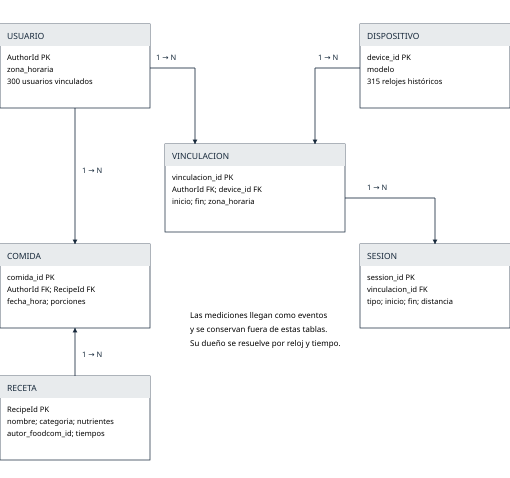
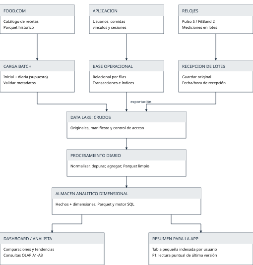

# INF3862 · Entrega 1


## Actividad física y características
de las recetas registradas

Matías Pozo Díaz · INF3862 · Entrega 1 · 16 de noviembre de 2026

### 1. Objetivo y alcance

Diseñar una plataforma que permita a cada usuario comparar las características de las recetas que registra entre sus días de mayor y menor actividad física. El producto final será un dashboard descriptivo; ayudará a reconocer patrones personales y decidir qué hábitos de registro o preparación desea revisar. No estima la dieta completa ni atribuye a la actividad un efecto causal sobre la alimentación.

| Pregunta guía | Decisión del proyecto |
| --- | --- |
| Resultado | Dashboard personal con tres comparaciones: densidad de proteína, densidad de fibra y tiempo de preparación de las recetas registradas. El equipo de producto podrá consultar resultados agregados. |
| Datos | Recetas Food.com; dispositivos, mediciones, sesiones y comidas del wearable. Las reseñas no se necesitan para este objetivo. El catálogo se cruza con comidas por RecipeId; la actividad se atribuye por reloj, vínculo y momento. |
| Operaciones | Normalizar dos formatos de reloj, deduplicar, resolver claves, convertir UTC a día local, resumir por usuario-día y comparar grupos dentro de cada usuario. |
| Exigencias | Supuestos de diseño: escrituras de la app con p95 ≤ 300 ms; dashboard ≤ 5 s; actualización diaria. Hasta 50 solicitudes operacionales concurrentes y 5 consultas analíticas. No se aceptan duplicados ni vínculos activos contradictorios. |
| Recursos | Piloto de 300 usuarios; una persona con Python y SQL, computador de 16 GB de RAM y 20 GB libres para una muestra. Presupuesto incremental local: US$0. Infraestructura cloud y procesamiento distribuido se evaluarán con medidas en E2/E3. |

### 2. Cómo se compararán los días

La unidad principal será **un usuario en una fecha local**. Un día tendrá cobertura suficiente si al menos el 75% de sus intervalos de cinco minutos contiene una medición válida del reloj. El denominador usa la duración real del día local, incluidos cambios de horario. Este criterio es una aproximación a la cobertura, no una garantía de uso continuo.

Se compararán los pasos del día con la mediana de sus días válidos en los **28 días calendario anteriores**, con al menos 14 días de referencia. Más pasos: «mayor actividad»; menos: «menor»; igualdad: «similar». Los días sin cobertura o historia suficiente no se clasificarán. Son umbrales de diseño que se revisarán al disponer de mediciones.

Cada indicador promedia primero las recetas válidas de un día y luego los días de cada grupo. La comparación exigirá al menos tres días con ese indicador en cada grupo. Así, un día con muchos registros no pesa más que otro. Los detalles de cálculo y calidad están en el anexo C.


## Fuentes y organización de los datos

### 3. Inventario verificado de los archivos recibidos

| Fuente | Filas físicas | MB en disco | Contenido y uso |
| --- | --- | --- | --- |
| Recetas | 522.517 | 178,723 | Catálogo; categorías, nutrientes y tiempos. Parquet con campos de lista. |
| Dispositivos | 315 | 0,020 | 300 usuarios; 300 vínculos sin fecha de término. CSV. |
| Comidas | 22.106 | 1,007 | Recetas preparadas registradas en la app. CSV. |
| Sesiones | 4.840 | 0,779 | Actividad registrada; 48 filas repetidas. JSONL. |
| Mediciones | Pendiente | Pendiente | No se recibió la carpeta. JSONL comprimido por día/hora de recepción, según LEEME_2.md. |

MB decimales (1 MB = 1.000.000 bytes). Conteos previos a limpieza, medidos sobre los adjuntos. Comidas y sesiones abarcan aproximadamente 60 días, entre diciembre de 2007 y febrero de 2008. reviews.parquet contiene 1.401.982 filas (173,762 MB), pero queda fuera del alcance. La captura no permite contar las mediciones.

### 4. Recepción y calidad

El trabajo académico comienza con una **carga batch de extractos históricos**. En una app operativa, comidas, sesiones y vínculos se registrarían en línea; los relojes enviarían lotes al sincronizarse y el catálogo se actualizaría diariamente. Se conserva el original antes de transformarlo: interpretación al leer en crudos y validación al escribir en tablas operacionales y analíticas.

Se detectaron 48 sesiones duplicadas y 48 comidas con RecipeId ausente del catálogo. Se conservará evidencia de esos casos: deduplicación por clave y contenido; las recetas desconocidas mantendrán una clave analítica de excepción y no aportarán nutrientes. Un valor ausente no será reemplazado por cero. Los problemas de las mediciones están documentados, pero aún no cuantificados.

### 5. Dos modelos según el patrón de acceso

| Nivel | Estructura propuesta y razón |
| --- | --- |
| Operacional<br>OLTP | Usuario, dispositivo, vinculación, receta, comida y sesión en un modelo relacional por filas. PK, FK e índices permiten escrituras pequeñas y búsquedas por usuario o ID. Cambiar un vínculo es una transacción; un reloj no admite vínculos temporales superpuestos. Diagrama y detalle: anexos B y G. |
| Analítico<br>OLAP | hecho_usuario_dia: una fila por usuario y fecha local, aun sin comidas. hecho_comida: una fila por registro deduplicado. Dimensiones usuario, fecha y receta. La actividad y las comidas se agregan por separado antes de unirse, para evitar multiplicar filas y sumas. Detalle: anexo C. |

Se conservarán crudos en un **Data Lake** y tablas integradas en un **almacén analítico dimensional** consultado por SQL. Las tablas limpias y analíticas usarán Parquet columnar; partición mensual por fecha de medición o fecha local, según la capa. El volumen inicial no justifica añadir gestión Delta/Iceberg ni denominar Lakehouse a un conjunto de archivos Parquet.


## Consultas, arquitectura y continuidad

### 6. Cargas de trabajo que sostienen el caso

| ID / clase | Propósito y usuario | Acceso y aceleración |
| --- | --- | --- |
| T1 · OLTP | La app cambia el usuario vinculado a un reloj. | Lee el reloj, cierra el vínculo anterior y crea el nuevo con BEGIN/COMMIT. Bloqueo por reloj, restricciones e índice de vínculo activo. |
| T2 · OLTP | El usuario registra una receta preparada. | Inserta una comida, comprueba usuario y receta. PK para reintentos; FK y porciones positivas. |
| T3 · OLTP | El usuario abre sus últimas 20 comidas. | Lectura acotada por usuario; índice compuesto por usuario, fecha e ID. |
| A1 · OLAP | El usuario compara proteína, fibra y preparación entre sus días de mayor y menor actividad. | Agrega días y calcula diferencias dentro de la misma persona. Columnas seleccionadas, filtro temporal y resumen precalculado. |
| A2 · OLAP | El usuario o analista revisa tendencias semanales. | Lee muchos usuario-día, agrupa por semana y muestra denominadores. Parquet y poda de particiones. |
| A3 · OLAP | El usuario compara categorías de recetas por nivel de actividad. | Cruza hechos y dimensiones; cuenta registros por categoría. Filtra ambas tablas por fecha. |
| F1 · frontera | La app abre una tarjeta de indicadores ya calculados. | Lectura puntual sobre un resumen indexado. El cálculo es OLAP; la consulta de servicio tiene patrón OLTP y no recalcula el historial. |

Los anexos D-F incluyen pseudocódigo, número de registros, frecuencia, latencia, concurrencia y optimización para cada consulta. Sin la transacción T1, una falla entre cerrar y crear un vínculo podría dejar el reloj sin asignación; cambios concurrentes sin coordinación podrían producir asignaciones incompatibles.

### 7. Arquitectura inicial y actualización

La base operacional atiende la aplicación. Sus exportaciones, el catálogo y los lotes de los relojes se conservan en crudos. Un proceso diario normaliza, controla calidad y construye las tablas analíticas. El dashboard consulta ese almacén; una tabla pequeña publica la última comparación personal para la app. El diagrama de capacidades está en el anexo H.

El diseño distingue **tiempo de medición y tiempo de recepción**. Un día es provisional hasta 48 horas después de su cierre local; se recalcula al recibir atrasos. Un atraso mayor dispara una corrección dirigida y la revisión de las clasificaciones de los 28 días siguientes. Cada publicación identifica archivos fuente, reglas y fecha de corte; se hace visible un conjunto completo de archivos, sin mezclar versiones parciales.

### 8. Trabajo previsto para E2 y E3

E2 implementará el flujo sobre una muestra, documentará reglas de calidad y ejecutará A1-A3. E3 construirá el dashboard con los tres indicadores y contrastará cada resultado con el promedio histórico personal. La referencia de clasificación usa únicamente días anteriores. Los parámetros y sus cambios se registran en decisiones.md; no se presentan aquí resultados analíticos no calculados.

Base documental: Enunciado.pdf, §§ 4-7; Clase00.pdf, diap. 19; Clase01.pdf, diap. 19-27, 29-40 y 43-71; LEEME_1.md y LEEME_2.md. Los detalles y límites de la inspección constan en el anexo I.


## Anexo A. Recepción, esquemas y crecimiento

Los volúmenes entregados constan en la página 2. La siguiente tabla describe la operación hipotética. Las latencias son objetivos de diseño, no mediciones del sistema. El dashboard se actualiza diariamente; no requiere streaming continuo.

| Fuente / registro / tipo | Recepción y esquema | Problemas y tratamiento previsto |
| --- | --- | --- |
| Recetas<br>Una receta. Estructurada, con campos anidados y texto libre. | Carga inicial de Parquet y actualización diaria del catálogo; cambios visibles en ≤ 24 h. Conservar original y su esquema; validar ID entero y tipos antes de la dimensión. | RecipeId está almacenado como double: comprobar integralidad antes de convertir a entero. Validar nutrientes y duraciones ISO 8601. Listas quedan en crudos; se proyectan solo los atributos necesarios. |
| Dispositivos<br>Una vinculación histórica de reloj a usuario. CSV estructurado. | Transacción de alta/cambio en la app (p95 ≤ 300 ms); exportación diaria. Schema-on-write en tablas de dispositivo y vinculación; la importación interpreta el CSV. | Múltiples relojes por usuario y fechas sin término. NULL en fecha_desvinculacion significa vínculo activo. Rechazar intervalos imposibles o superpuestos para el mismo reloj. |
| Comidas<br>Una receta preparada y registrada. CSV estructurado. | Transacción al guardar en la app (p95 ≤ 300 ms); extracto diario. Esquema y FK antes de escribir en operación; original preservado al importar. | Claves desconocidas, ID repetido, porciones inválidas. En historia, receta desconocida = dimensión 0 y nutrientes NULL; en nuevas transacciones, FK impide registrarla. |
| Sesiones<br>Una actividad registrada. JSONL semiestructurado. | Envío al terminar o sincronizar; aceptación en ≤ 2 s desde que llega a la app. Interpretar JSON y validar antes de almacenar sesión normalizada. | Reintentos, inicio/fin erróneos y sesiones que cruzan días. Deduplicar por session_id y contenido; asignar vínculo por tiempo. Distancia nula en fuerza es válida. |
| Mediciones<br>Una observación del reloj. JSONL.gz semiestructurado. | Lotes cuando el reloj sincroniza; aceptación ≤ 2 s para un lote habitual, a validar. Original por fecha/hora de recepción; schema-on-read al normalizar modelos. | Duplicados, retrasos, nulos y frecuencia variable. Convertir epoch ms e ISO 8601 a UTC; mapear nombres; deduplicar por dispositivo y ts_medicion. No sumar calorías de sesiones y mediciones. |

### Supuesto cuantitativo de crecimiento

Escenario de capacidad: 300 usuarios, un reloj activo por usuario (189 Pulso S y 111 FitBand 2, según el archivo), 24 h de registro, una sesión de 30 min y dos comidas por usuario-día. Catálogo: 100 recetas nuevas/día; recambio de relojes: 3 vínculos/mes. Son supuestos, no tasas observadas.

| Fuente | Crecimiento ilustrativo |
| --- | --- |
| Mediciones | Pulso: 1.440 − 30 + 180 = 1.590 filas/reloj-día. FitBand: 288 − 6 + 180 = 462. Total: 189 × 1.590 + 111 × 462 = 351.792 filas/día. A 200 bytes/JSON sin comprimir: 70,4 MB/día (~2,11 GB/30 días). |
| Otras fuentes | Comidas: 600 filas/día (~27 kB); sesiones: 300/día (~48 kB); vínculos: 3/mes (~189 bytes); recetas: 100/día (~34 kB Parquet). Tamaños aproximados usando bytes/fila de los adjuntos y compresión constante. |

No se conoce el tamaño comprimido ni el número real de mediciones. La estimación excluye reintentos, metadatos, réplicas, índices y copias por capas; no dimensiona por sí sola una plataforma de producción.


## Anexo B. Modelo operacional y restricciones

Modelo principal: relacional por filas. Las consultas identifican registros o modifican pocas entidades relacionadas; PK/FK, restricciones y transacciones acompañan ese patrón. Los campos del modelo son de diseño; los extractos históricos se adaptarán a ellos.

| Entidad y clave | Columnas principales / relaciones | Acceso y restricciones |
| --- | --- | --- |
| usuario<br>PK AuthorId | zona_horaria. Para el piloto, usuarios de dispositivos.csv. La zona se toma de sus vínculos si es coherente; contradicciones requieren revisión. | Búsqueda por ID. No se infieren perfiles demográficos ni se utiliza autor_foodcom_id como usuario que prepara la receta. |
| dispositivo<br>PK device_id | modelo ∈ {Pulso S, FitBand 2}. | Búsqueda y bloqueo por reloj. Separar el aparato de su historial de vinculación. |
| vinculacion<br>PK vinculacion_id | device_id FK → dispositivo; AuthorId FK → usuario; inicio; fin; zona_horaria. ID técnico estable generado en la importación. | Índices por device_id/inicio y AuthorId/inicio. fin > inicio o NULL; intervalos [inicio, fin) no superpuestos por reloj; a lo sumo un vínculo activo por dispositivo. |
| receta<br>PK RecipeId | nombre; autor_foodcom_id; categoria; calorias; proteina; fibra; prep_iso; ingredientes/instrucciones opcionales. autor_foodcom_id es un identificador externo del catálogo. | Búsqueda por RecipeId. El autor de la receta no tiene por qué ser usuario del piloto. Los atributos de lista pueden preservarse como JSON; no se expanden para el análisis propuesto. |
| comida<br>PK comida_id | AuthorId FK → usuario; RecipeId FK → receta; fecha_hora UTC; porciones. | Índice (AuthorId, fecha_hora DESC, comida_id DESC). CHECK porciones > 0. La PK sirve como ID de solicitud estable ante reintentos. |
| sesion<br>PK session_id | vinculacion_id FK → vinculacion; tipo; inicio/fin UTC; distancia_km; calorias. El vínculo se resuelve usando device_id e inicio del archivo. | Índice (vinculacion_id, inicio). fin > inicio; sesión dentro del vínculo; distancia NULL permitida en fuerza. Duplicado idéntico no vuelve a insertarse. |

### Integridad transaccional

El cambio de dueño de un reloj cierra el vínculo vigente e inserta el nuevo dentro de una misma transacción. Un bloqueo del registro del dispositivo coordina operaciones concurrentes. La unicidad del vínculo activo y la prohibición de intervalos superpuestos complementan la transacción; no basta con revisar en la aplicación y luego insertar sin protección.

### Tratamiento de las mediciones

Los lotes se conservan en almacenamiento de objetos, con identificación de archivo y recepción. La capa limpia adopta un modelo de serie temporal: clave lógica (device_id, ts_medicion), vínculo derivado y valores normalizados. Las consultas por reloj y rango de tiempo se satisfacen con organización temporal; no se fuerza cada lectura del reloj a las tablas de operación de la app.

Si dos relojes de un mismo usuario producen datos en intervalos superpuestos, el diseño no los suma: esos intervalos se marcan ambiguos y quedan fuera de los agregados hasta resolver su procedencia. Se conserva el dato original. Esto evita inflar los pasos por doble registro.


## Anexo C. Modelo analítico y definición de indicadores

| Tabla / granularidad | Claves y atributos o medidas |
| --- | --- |
| dim_usuario<br>Una fila por usuario del piloto. | PK usuario_id (= AuthorId); zona_horaria y procedencia. Sin datos personales adicionales. Versionar la dimensión junto con cada publicación. |
| dim_fecha<br>Una fila por fecha local. | PK fecha_id (AAAAMMDD); fecha, año, mes, anio_iso, semana_iso y día de semana. La duración UTC de cada día se obtiene con la zona del usuario. |
| dim_receta<br>Una fila por RecipeId del snapshot. | PK receta_id (= RecipeId); nombre, categoría, Calories, ProteinContent, FiberContent, PrepTime y prep_min normalizado. Fila 0 para receta desconocida. |
| hecho_comida<br>Una fila por comida_id deduplicado. | PK comida_id; FK usuario_id, fecha_id, receta_id. fecha_hora UTC, fecha_local, porciones, proteína_100kcal, fibra_100kcal, prep_min y marcas de calidad. Cada métrica inválida queda NULL. |
| hecho_usuario_dia<br>Una fila por usuario y fecha local del período vinculado. | PK (usuario_id, fecha_id); ambas FK. fecha_local; pasos_dia; minutos_sesion; cobertura; dia_valido; dia_cerrado; mediana_previa; n_dias_referencia; clase_actividad; n_comidas; medias y n válidos por indicador. |
| resumen_usuario_metricas<br>Una fila por usuario, métrica y ventana. | Clave (usuario_id, metrica, ventana_dias); medias mayor/menor, diferencia, n_mayor/n_menor y corte_recepcion_utc. Se sirve la última versión completa a la app; no es la fuente de verdad. |

### Cálculos y denominadores

Por receta: proteína por 100 kcal = 100 × ProteinContent / Calories; fibra por 100 kcal = 100 × FiberContent / Calories. Requieren Calories > 0 y nutrientes finitos no negativos, expresados sobre una misma base. Se verificarán unidades y coherencia antes de E2. PrepTime se convierte de duración ISO 8601 a minutos; se descartan valores no interpretables, no los tiempos cero válidos.

Cada comida válida aporta una observación de las características de la receta. La media diaria no pondera por porciones, pues describe recetas registradas, no ingesta total. Para cada métrica se guarda su número de registros válidos. No se calculan calorías consumidas ni balance energético. A1 promedia días por persona y exige ≥ 3 días por grupo y métrica.

Para pasos se exige tiempo interpretable, vínculo resoluble y valor finito no negativo; una frecuencia cardíaca nula no invalida los pasos. Duplicados idénticos de (device_id, ts_medicion) conservan la primera recepción; valores contradictorios para esa clave se apartan para revisión. Se suman incrementos de pasos después de deduplicar; no se suman contadores acumulados. La cobertura cuenta intervalos de cinco minutos con al menos un registro válido, de modo que las muestras de 10 s de una sesión no aumentan artificialmente la cobertura. Los minutos de sesión se obtienen de la unión de intervalos, divididos al cruzar medianoche local.

Se construye un calendario usuario-día. Ausencia de reloj válido implica pasos NULL, nunca cero. n_comidas = 0 significa ningún registro disponible, no ayuno. Primero se agrega cada fuente al nivel usuario-día y después se unen los resultados 1:1; las comidas conservan su tabla de detalle.

### Organización física y publicación

Crudos: originales inmutables, particionados según recepción. Limpios: Parquet por mes de ts_medicion UTC para mediciones y por fecha pertinente en otras fuentes. Hechos: Parquet por mes de fecha_local; dimensiones sin partición. Proyección de columnas y poda mensual benefician A1-A3. Se evita particionar por usuario por el riesgo de archivos pequeños. Cada versión publica un manifiesto completo y una fecha de corte; los lectores usan una sola versión.


## Anexo D. Consultas transaccionales

### T1. Cambiar la vinculación de un reloj

```sql
BEGIN;
SELECT device_id FROM dispositivo
WHERE device_id = :reloj FOR UPDATE;
UPDATE vinculacion SET fin = :instante
WHERE device_id = :reloj AND fin IS NULL;
INSERT INTO vinculacion
 (vinculacion_id, device_id, AuthorId, inicio, fin, zona_horaria)
VALUES (:id, :reloj, :usuario, :instante, NULL, :zona);
COMMIT; -- ROLLBACK de toda la unidad ante un error.
```

La app ejecuta una operación pequeña: lee un reloj, actualiza como máximo un vínculo activo e inserta otro. Sin atomicidad, una falla tras cerrar el vínculo deja la operación incompleta. Sin coordinación, dos solicitudes simultáneas pueden competir por el mismo reloj. Validar usuario, fechas y no superposición forma parte de la unidad de trabajo.

### T2. Registrar una receta preparada

```sql
INSERT INTO comida
 (comida_id, AuthorId, RecipeId, fecha_hora, porciones)
VALUES (:id_solicitud, :usuario, :receta, :utc, :porciones);
-- PK y FK; CHECK(porciones > 0).
-- Reintento idéntico: devolver el registro existente.
-- Mismo ID con otro contenido: rechazar el conflicto.
```

El usuario guarda una comida. Se escribe una fila y se verifican dos referencias. Es OLTP por su alcance acotado y prioridad de respuesta. La aplicación conserva el ID de la solicitud al reintentar; dos comidas distintas pueden referirse a la misma receta y hora, por lo que no se deduplican solo por esos campos.

### T3. Consultar las últimas comidas

```sql
SELECT c.comida_id, c.fecha_hora, r.nombre, c.porciones
FROM comida c JOIN receta r ON r.RecipeId=c.RecipeId
WHERE c.AuthorId=:usuario
ORDER BY c.fecha_hora DESC, c.comida_id DESC LIMIT 20;
```

La app recupera hasta 20 comidas y sus recetas. El JOIN no convierte por sí solo la consulta en OLAP: se mantiene un acceso puntual, acotado e interactivo.

| Consulta | Frecuencia, latencia y concurrencia supuestas | Qué la hace rápida |
| --- | --- | --- |
| T1 | Al vincular o cambiar reloj; p95 ≤ 300 ms. Forma parte de hasta 50 solicitudes operacionales simultáneas; cambios al mismo reloj se serializan. | PK de dispositivo, índice de vínculo activo y transacción breve. |
| T2 | Al registrar comida; 600 escrituras/día en el escenario de capacidad. p95 ≤ 300 ms; hasta 50 solicitudes operacionales concurrentes. | PK de comida, PK de referencias e inserción por filas. |
| T3 | Al abrir el historial, varias veces al día por usuario; p95 ≤ 300 ms; hasta 50 solicitudes concurrentes. | Índice (AuthorId, fecha_hora DESC, comida_id DESC), LIMIT e índice de receta. |


## Anexo E. Consulta analítica central

### A1. Diferencias entre días de mayor y menor actividad

Responde directamente al objetivo. El usuario o analista consulta un intervalo de fechas; la clasificación ya está construida a partir de los 28 días anteriores a cada fecha. Las comparaciones se hacen dentro de cada usuario y para cada métrica.

```sql
WITH valores AS (
 SELECT h.usuario_id, h.clase_actividad, v.metrica, v.valor
 FROM hecho_usuario_dia h
 CROSS JOIN LATERAL (VALUES
  ('proteina_g_100kcal', h.proteina_100kcal_media),
  ('fibra_g_100kcal', h.fibra_100kcal_media),
  ('preparacion_min', h.prep_min_media)
 ) AS v(metrica, valor)
 WHERE h.fecha_local BETWEEN :desde AND :hasta
  AND h.dia_cerrado AND h.dia_valido
  AND h.clase_actividad IN ('mayor','menor')
  AND v.valor IS NOT NULL
), resumen AS (
 SELECT usuario_id, metrica, clase_actividad,
        COUNT(*) AS dias, AVG(valor) AS media
 FROM valores
 GROUP BY usuario_id, metrica, clase_actividad
)
SELECT a.usuario_id, a.metrica,
       a.dias AS n_mayor, b.dias AS n_menor,
       a.media AS media_mayor, b.media AS media_menor,
       a.media-b.media AS diferencia
FROM resumen a JOIN resumen b
 ON a.usuario_id=b.usuario_id AND a.metrica=b.metrica
WHERE a.clase_actividad='mayor' AND b.clase_actividad='menor'
 AND a.dias>=3 AND b.dias>=3;
```

| Criterio | Justificación |
| --- | --- |
| OLAP | Lectura y agregación histórica. El resultado pequeño requiere examinar muchos usuario-día. No modifica el registro operacional de comidas ni relojes. |
| Volumen | Hasta ~18.000 usuario-día para 300 usuarios y 60 días, antes de filtros; la expansión produce hasta tres valores por día. Estas son cotas de diseño, no filas analíticas ya construidas. |
| Frecuencia / exigencia | Una ejecución diaria para precalcular el resumen y consultas bajo demanda; objetivo ≤ 5 s y hasta 5 consultas analíticas concurrentes. |
| Optimización | Particiones por mes de fecha_local, lectura solo de columnas necesarias y resumen por usuario-métrica. La app usa F1 para no recalcular el historial en cada apertura. |
| Interpretación | Diferencia = media de días de mayor actividad menos media de días de menor actividad. Una comparación de cohorte promedia esas diferencias con igual peso por persona y muestra los usuarios incluidos; no mezcla directamente personas con hábitos distintos. |


## Anexo F. Otras consultas analíticas y caso frontera

### A2. Tendencias semanales por usuario

```sql
SELECT h.usuario_id, f.anio_iso, f.semana_iso,
 AVG(h.pasos_dia) AS pasos, AVG(h.minutos_sesion) AS minutos,
 AVG(h.proteina_100kcal_media) AS proteina,
 AVG(h.prep_min_media) AS preparacion,
 COUNT(*) AS dias, COUNT(h.proteina_100kcal_media) AS dias_prot,
 COUNT(h.prep_min_media) AS dias_prep
FROM hecho_usuario_dia h JOIN dim_fecha f USING(fecha_id)
WHERE h.fecha_local BETWEEN :desde AND :hasta
 AND h.dia_cerrado AND h.dia_valido
GROUP BY h.usuario_id, f.anio_iso, f.semana_iso;
```

Lectura OLAP de hasta ~18.000 usuario-día del piloto, agrupada por semana. Para el usuario o analista; actualización diaria y consultas bajo demanda, ≤ 5 s, hasta 5 concurrentes. AVG omite NULL: se muestran los denominadores de cada indicador. Parquet y el filtro temporal reducen lecturas.

### A3. Categorías de recetas según actividad

```sql
WITH conteos AS (
 SELECT c.usuario_id, h.clase_actividad, r.categoria,
        COUNT(*) AS registros
 FROM hecho_comida c JOIN dim_receta r USING(receta_id)
 JOIN hecho_usuario_dia h
  ON c.usuario_id=h.usuario_id AND c.fecha_id=h.fecha_id
 WHERE h.fecha_local BETWEEN :desde AND :hasta
  AND c.fecha_local BETWEEN :desde AND :hasta
  AND h.dia_cerrado AND h.dia_valido
  AND h.clase_actividad IN ('mayor','menor') AND c.receta_id<>0
 GROUP BY c.usuario_id, h.clase_actividad, r.categoria
)
SELECT *, 1.0*registros / SUM(registros) OVER
 (PARTITION BY usuario_id,clase_actividad) AS proporcion
FROM conteos;
```

Lectura OLAP sobre hasta 22.106 comidas y sus dimensiones, antes de filtros. Compara registros por categoría dentro de cada persona, no porciones ni personas. Diaria y bajo demanda, ≤ 5 s, hasta 5 concurrentes. Filtrar ambos hechos permite poda; el JOIN usuario-fecha es N:1. Categoría nula se muestra como «Sin categoría»; receta desconocida se excluye y se informa aparte.

### F1. Una tarjeta consultada en tiempo real

```sql
SELECT metrica, media_mayor, media_menor, diferencia,
       n_mayor, n_menor, corte_recepcion_utc
FROM resumen_usuario_metricas
WHERE usuario_id=:usuario AND ventana_dias=28;
```

La app lee hasta tres filas, varias veces por día por usuario; p95 ≤ 300 ms y hasta 50 solicitudes simultáneas. Es un acceso con patrón OLTP a un resultado analítico: su cálculo es OLAP y se hace diariamente fuera de la base operacional. Se usa una tabla de servicio con índice por usuario/ventana y se muestra la fecha de actualización. «Tiempo real» describe la respuesta, no la frescura del dato.


## Anexo G. Diagrama entidad-relación operacional

PK: clave primaria. FK: clave foránea. La flecha va desde la entidad referenciada hacia la entidad que contiene la referencia; 1 → N expresa una relación uno a muchos.



Un usuario puede tener varias vinculaciones históricas y varias comidas. Un dispositivo puede tener varias vinculaciones sucesivas; no simultáneas. Una sesión pertenece a una vinculación. Una receta puede aparecer en muchas comidas. Se admite cero o más registros en el extremo N.

La importación divide dispositivos.csv en usuario, dispositivo y vinculación. La sesión recibe vinculacion_id al resolver su device_id y tiempo; el archivo original no contiene ese identificador técnico. La relación entre medición y usuario también es temporal, no un JOIN que ignore las fechas de vinculación.


## Anexo H. Arquitectura inicial por capacidades

La arquitectura separa las escrituras de la aplicación de las lecturas históricas. En el piloto, estas capacidades pueden ejecutarse localmente; el diagrama no exige un servicio cloud independiente para cada caja. No se seleccionan proveedores en E1.



El procesamiento conserva resultados limpios, incidencias de calidad y metadatos. El almacén analítico es un diseño tipo Warehouse; el motor SQL y los archivos cumplen funciones distintas. Publicar un manifiesto completo evita que un dashboard combine archivos de ejecuciones distintas. El aislamiento de cómputo se dimensionará si aparece competencia por recursos.


## Anexo I. Evidencia, límites y decisiones iniciales

| Comprobación realizada | Resultado | Implicación para el diseño |
| --- | --- | --- |
| Claves del catálogo | 522.517 RecipeId; sin nulos, duplicados ni valores fraccionarios. Tipo físico double. | Convertir a entero después de validar; preservar ID original en crudos. |
| Población del wearable | 315 dispositivos; 300 usuarios y 300 registros sin fecha de desvinculación. Sin zonas contradictorias entre relojes del mismo usuario. | No confundir filas de dispositivos con personas. Crear una dimensión por usuario y mantener historial de vínculos. |
| Comidas | 22.106 IDs distintos; 48 filas con RecipeId fuera del catálogo; sin porciones ≤ 0. | 48 / 22.106 = 0,217% sin receta resoluble. Mantener incidencia y no inventar nutrientes. |
| Sesiones | 4.840 filas; 48 repeticiones completas y 48 IDs repetidos. 4.792 filas tras deduplicación exacta. | Deduplicación idempotente. No multiplicar minutos o calorías por reintentos. |
| Distancia de sesión | 793 valores nulos; corresponden a las 793 filas de tipo fuerza. | La ausencia es válida según el diccionario; no imputar cero ni tratarla como error general. |
| Nutrición | 3.111 recetas con Calories = 0. Entre comidas enlazadas, 21.941 registros admiten razón de proteína con Calories > 0 y proteína ≥ 0. | Densidades indefinidas permanecen NULL; informar denominadores. Esto no valida aún toda la semántica nutricional. |
| Mediciones | Solo descripción y captura; no se inspeccionaron registros. | Volumen, cobertura, retrasos y duplicados reales quedan pendientes. No hay resultados sobre pasos ni grupos de actividad. |

### Decisiones revisables

Se adopta un caso descriptivo, una clasificación relativa a cada usuario, cobertura mínima del 75%, ventana retrospectiva de 28 días con 14 días válidos y cierre provisional de 48 h. Se comparan características de recetas y no ingesta total. Se usan Parquet y un modelo dimensional; se posterga Lakehouse y cómputo distribuido hasta justificar su necesidad. decisiones.md registra alternativas y motivos.

### Límites de interpretación

El wearable del curso es sintético y las recetas registradas no describen toda la alimentación. La frecuencia de registro y la disponibilidad del reloj pueden seleccionar los días comparables. La asociación observada no identifica causalidad ni constituye recomendación nutricional. Los días similares y los datos insuficientes se informan por separado. Los umbrales deben revisarse si dejan pocos días comparables.

### Fuentes y reproducibilidad

Material entregado: Enunciado.pdf (requisitos E1-E3 y registro de decisiones), Clase00.pdf (cinco preguntas), Clase01.pdf (OLTP/OLAP, modelos, almacenamiento y arquitectura), LEEME_1.md y LEEME_2.md. Catálogo original: Food.com - Recipes and Reviews, Kaggle, irkaal/foodcom-recipes-and-reviews; licencia CC0 según LEEME_1.md. Inspección local de los adjuntos: 16-11-2026.

El repositorio incluirá este informe, la fuente Markdown, consultas.sql, los diagramas, README.md, datos/README.md y decisiones.md. No se incluyen los datasets. E1 contiene diseño y pseudocódigo; los agregados y tiempos de consulta se implementarán y medirán en E2.
